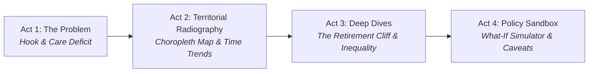

# The Healthcare Mirage: Mapping France’s Medical Deserts & Care Deficit

[](https://www.python.org/)
[](https://streamlit.io/)
[](https://www.etalab.gouv.fr/licence-ouverte-open-licence/)

**Individual Student Project: Streamlit Dashboard**  
**Course**: Data Visualization & Storytelling (EFREI Paris)  
**Instructor**: Mano Joseph Mathew (mano.mathew@efrei.fr)  
**Student**: Alexandre Morin (ID: 20230873 | Group: DAI)  
**Submission Archive**: `StApp26_20230873_MORIN_DAI.zip`  
**Hashtags**: #EFREIDataStories2026 #EFREIParis #DataVisualization #Streamlit #DataStorytelling #OpenData #PublicData

---

## Executive Summary & Problem Framing

Despite France’s constitutional guarantee of equal access to healthcare, finding an available General Practitioner has become an uphill battle for millions of citizens. In 2024, **over 12.3 million French citizens (18.2% of the total population)** reside in certified primary care deserts where accessible consultations plunge below the official critical threshold of **2.5 consultations/year/inhabitant**.

Worse, France stands on the brink of an unprecedented **demographic cliff**: **27.5% of total consultation capacity is provided by doctors aged 60 and older**. In fragile rural departments (such as Mayenne, Indre, or Creuse), this ratio exceeds **35%**, setting the stage for an acute structural care collapse within 3 to 5 years.

This interactive Streamlit dashboard guides policymakers, regional health directors, and citizens through a **four-act data story**—from national diagnostics to an actionable **What-If Policy Sandbox**.

---

## Storytelling Arc



1. **Act 1: The Looming Crisis (Problem Framing)**
   - *Headline Insight*: 18.2% of citizens in medical deserts; 27.5% of consultation capacity facing imminent retirement.
   - *Context & Audience*: Regional Health Agencies (ARS), municipal mayors, patient advocacy groups.
   - *The Metric*: DREES APL (Localised Potential Accessibility) and its official threshold (2.5 consult./hab/yr).

2. **Act 2: Territorial Radiography (Map & Macro Trends)**
   - *Interactive Choropleth Map*: 100 departments visualized by APL, % population in desert, 2-year evolution, or doctor aging.
   - *KPIs with Deltas*: Instant comparison against national baselines (3.72 APL).
   - *Time Series (2022–2024)*: Tracking territorial divergence vs. the critical threshold band.

3. **Act 3: The Retirement Cliff & Spatial Injustice (Deep Dives)**
   - *Intra-departmental Disparities*: Box plots revealing extreme inequality within seemingly average departments (e.g. Mayenne).
   - *Correlation Scatter*: APL vs. Doctor Aging ratio, exposing the "Double Jeopardy" red quadrant.
   - *Regional Rankings & Commune Search*: Priority watchlist of vulnerable communes.

4. **Act 4: What-If Policy Sandbox & Strategic Caveats**
   - *Interactive Policy Simulator*: Simulates deployment of new subsidized doctors and telemedicine productivity boosts.
   - *Data Quality & Limitations*: Automobile distance assumptions, administrative lags, out-of-hospital scope.
   - *Ethics & Uncertainty*: Distinguishing correlation from causality; strict privacy via municipal aggregation.

---

## Repository Architecture

```
Dataviz projet/
├── app.py                   # Main application entry point & layout
├── sections/                # The 4 Story Chapters (Modular Architecture)
│   ├── intro.py             # Act 1: Problem framing, hook, definitions & metadata
│   ├── overview.py          # Act 2: KPI metrics with deltas, choropleth map, time series
│   ├── deep_dives.py        # Act 3: Boxplots, aging correlation scatter, commune search
│   └── conclusions.py       # Act 4: What-if policy simulator, caveats & ethics
├── utils/                   # Data processing and chart engines
│   ├── config.py            # Project constants, student IDs, thresholds
│   ├── departments.py       # French departments and regions mapping
│   ├── io.py                # Downloaders, GeoJSON cache, cached parquet loaders
│   ├── prep.py              # Feature engineering, aggregations, national summary
│   └── viz.py               # Standardized Plotly chart generators
├── data/
│   ├── raw/                 # Downloaded official DREES Excel & GeoJSON
│   └── processed/           # Optimized Parquet caches (3.0 MB)
├── requirements.txt         # Pinned Python dependencies
└── README.md                # Complete documentation and video demo script
```

---

## Quickstart & Reproducibility

### 1. Prerequisites
- **Python**: >= 3.10 (tested on Python 3.12)
- **Virtual Environment** (recommended):

```bash
# Clone or extract repository
cd "d:\Doc_efrei\Dataviz projet"

# Create and activate virtual environment
python -m venv .venv
# Windows:
.venv\Scripts\activate
# Mac / Linux:
source .venv/bin/activate

# Install dependencies
pip install -r requirements.txt
```

### 2. Launch the Application
```bash
streamlit run app.py
```
The app automatically loads the processed DREES data (or downloads and processes the raw data if missing), and launches in your default web browser at `http://localhost:8501`.

---

## Data Provenance & Dictionary

| Dimension | Details |
| :--- | :--- |
| **Source Dataset** | *Accessibilité Potentielle Localisée (APL) aux médecins généralistes* |
| **Producer** | DREES (Direction de la recherche, des études, de l'évaluation et des statistiques) |
| **Portals** | [data.gouv.fr](https://www.data.gouv.fr/fr/datasets/accessibilite-potentielle-localisee-apl-aux-professionnels-de-sante/) / [data.drees.solidarites-sante.gouv.fr](https://data.drees.solidarites-sante.gouv.fr/explore/dataset/530_l-accessibilite-potentielle-localisee-apl/information/) |
| **License** | Open Licence 2.0 (Etalab) — Academic and commercial reuse permitted |
| **Temporal Granularity** | 2022, 2023, 2024 annual millésimes |
| **Spatial Granularity** | 34,890 communes aggregated to 100 departments and 13 administrative regions |

### Key Computed Features
- **`weighted_apl`**: Population-weighted mean consultations accessible per inhabitant per year.
- **`is_desert`**: Boolean indicator flagging communes where APL < 2.5.
- **`retirement_cliff_pct`**: Proportion of consultation capacity provided by doctors aged 60 and older.
- **`desert_pop`**: Total residents living in communes classified as medical deserts.

---

## Data Ethics, Bias & Uncertainty

1. **Travel Distance Assumptions**: APL computation utilizes Insee's Metric distance matrix calculated exclusively by **private automobile travel**. It omits public transportation constraints, systematically understating isolation for non-driving elderly and low-income populations.
2. **Administrative Delay vs. Practice Reality**: Data is based on National Health Insurance (SNIIR-AM) reimbursement activity. Recent doctor departures, part-time reductions, or retirements may take up to 12 months to reflect in official indices.
3. **Correlation vs. Causality**: Medical deserts closely intersect with rural de-industrialization and demographic decline. Low APL is an aggravating symptom of territorial neglect, not its sole unilateral driver.
4. **Privacy Protection**: Data is aggregated at commune and departmental scales to eliminate any individual patient or practitioner identification risk.

---

## Demo Video Walkthrough Script (3 min 41 s)

| Time | Storyboard Segment | Visual Focus on Screen | Spoken Script / Talking Points |
| :---: | :--- | :--- | :--- |
| **0:00 - 0:43** | **Act 1: The Problem** | Banner, Headline Insight, DREES indicator card & formula | *"Hello sir, today I'm going to present you my data story on medical deserts in France. Access to healthcare is a fundamental right, yet millions of citizens struggle to find an available doctor. We use official open data from the Ministry of Health covering all 35,000 French municipalities from 2022 to 2024. The core indicator is the APL: by official standards, any town below 2.5 visits per person is classified as a medical desert."* |
| **0:44 - 1:37** | **Act 2: Territorial Radiography** | 4 KPI cards with deltas, Choropleth Map, Trajectory chart | *"Moving to Act 2, national numbers appear stable at 3.72 visits per person. However, this masks severe inequality: 18.2% of the population—over 12.3 million citizens—live in medical deserts, and 27.5% of care capacity is held by doctors aged 60 and older. On the map, looking at the 2-year shift since 2022, rural and peri-urban departments show a sharp drop. The trend chart confirms access is dropping nationwide."* |
| **1:38 - 2:34** | **Act 3: Deep Dives & Aging** | Intra-departmental boxplot (Mayenne), Scatter plot | *"In Act 3, we dive into hidden realities. First, strong inequalities exist inside departments: in Mayenne, despite an average of 2.77, nearly 60% of communes are in a desert. Second, crossing access with doctor age reveals a red danger quadrant in the bottom-right: departments with APL below 2.5 where over 35% of doctors will retire in the next 5 years, risking care collapse."* |
| **2:35 - 3:41** | **Act 4: Policy Simulator & Caveats** | Simulator sliders, Before/After chart, Caveats & Conclusions | *"Finally, in our policy simulator, adding 2,000 new doctors and a 10% telemedicine boost rescues over 3.6 million citizens and 4,000 communes. We also document limitations: travel times assume private car ownership, underestimating isolation for elderly citizens who cannot drive. In conclusion, solutions require targeted grants, multi-disciplinary health hubs, and digital triage. Thank you."* |

---

## Submission Packaging Checklist

- [x] Streamlit App deployable locally and on Streamlit Community Cloud.
- [x] Official open dataset sourced from DREES / data.gouv.fr with Etalab 2.0 license.
- [x] Reproducible environment with pinned `requirements.txt`.
- [x] Documented data cleaning, feature engineering, and Parquet caching (`@st.cache_data`).
- [x] Four-act narrative aligned with Professor Mano Joseph Mathew's syllabus.
- [x] Demo video completed (3 min 41 s, within the 2 to 4 minute requirement).
- [x] Archive format: `StApp26_20230873_MORIN_DAI.zip`.
